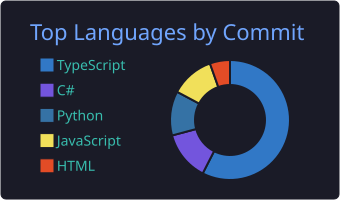
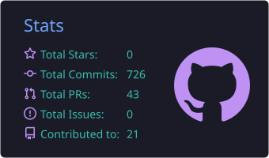
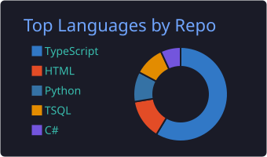
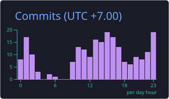

<h1 align="center">
    
</h1>

<h3 align="center">
    
</h3>

  
  

 

 🔭 I’m currently working on **Yoca – Solana On-Chain Analytics Platform**

 ✍️ I'm currently studying at **University of Science**, **National University of Ho Chi Minh City**

 🌱 I’m currently learning **NestJS, System Design, Graph-based Anomaly Detection**

 💬 Ask me about **React, Node.js, PostgreSQL... or anything [here](https://github.com/vow130504/vow130504/issues)**

 

  
  
  
  

 

<h2 align="center">⚒️ Languages-Frameworks-Tools ⚒️</h2>
 

      
      
    

 

  <h2>🐍 My Contributions 🐍</h2>
   
  <picture>
    <source media="(prefers-color-scheme: dark)" srcset="https://raw.githubusercontent.com/vow130504/vow130504/output/snake-dark.svg" />
    <source media="(prefers-color-scheme: light)" srcset="https://raw.githubusercontent.com/vow130504/vow130504/output/snake.svg" />
    
  </picture>
    

  <h2> ⚡ Stats ⚡ </h2>
   
  
  
  
    

<b>📊 More stats</b>

 
  
  

 

<h1 align="center">
    
</h1>

