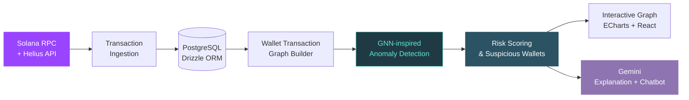

<!-- ========================= HEADER ========================= -->
<div align="center">


<a href="https://github.com/YOUR_USERNAME">
  
</a>

<br/>


<br/><br/>

<a href="mailto:minhthienqbatri28@gmail.com"></a>
<a href="https://www.linkedin.com/in/YOUR_LINKEDIN"></a>
<a href="https://github.com/YOUR_USERNAME"></a>

</div>

<br/>

<!-- ========================= ABOUT ========================= -->
## 👨‍💻 About Me

```yaml
name:        Nguyen Minh Thien
role:        Fullstack Software Engineer (Intern-level)
education:   B.Eng. Software Engineering @ VNUHCM – University of Science (2022 – now)
gpa:         9.00 / 10.00  # Excellent
looking_for: Backend / Full-stack Internship
focus:       [ React, Node.js, NestJS, PostgreSQL, Solana on-chain data ]
```

- 🎓 Final-year student at **VNUHCM – University of Science**, majoring in Software Engineering
- 🔭 Built **Yoca**, a Solana on-chain analytics platform, owning the **Wash Trading Detection** module end-to-end
- 🛒 Shipped an MVC e-commerce app with **JWT auth** and **VNPAY** payment integration
- 🌱 Currently deepening: **NestJS**, system design, graph-based anomaly detection
- 🏅 Scholarships: **VNU-HCM Dormitory** (×2) · **Lotte Scholarship**

<br/>

<!-- ========================= TECH STACK ========================= -->
## 🛠️ Tech Stack

<div align="center">

**Languages**<br/>
<br/><br/>

**Frontend**<br/>
<br/><br/>

**Backend**<br/>

<br/><br/>

**Databases**<br/>

<br/><br/>

**Tools & DevOps**<br/>
<br/><br/>

**Web3 & Data**<br/>


</div>

<details>
<summary><b>📚 Fundamentals</b></summary>
<br/>

`Data Structures & Algorithms` · `OOP` · `Databases` · `RESTful API Design` · `MVC` · `Authentication (JWT, Passport.js)` · `Payment Gateway Integration` · `Data Visualization`

</details>

<br/>

<!-- ========================= PROJECTS ========================= -->
## 🚀 Featured Projects

<table>
<tr>
<td width="50%" valign="top">

### 🔍 Yoca — Solana On-Chain Analytics & Wallet Visualizer
<sub>08/2025 – 08/2026 · Team of 6 · Full Stack Developer · Grade **9.2**</sub>

A Solana analytics platform for analyzing token transactions, wallet behavior, and suspicious trading activity.

**My contribution — Wash Trading Detection module (end-to-end):**
- 🕸️ GNN-inspired graph anomaly detection on Solana transaction graphs
- 📊 Interactive transaction-network visualization & risk scoring
- ⚡ On-chain data pipeline via **Solana RPC + Helius API**
- 🤖 **Gemini** explains detection results + context-aware AI chatbot


<br/><br/>
<a href="https://github.com/YOUR_USERNAME/YOCA_REPO"></a>

</td>
<td width="50%" valign="top">

### 📚 Online Book Sales Management Application
<sub>10/2024 – 01/2025 · Team of 3 · Full Stack Developer · Grade **9.4**</sub>

An MVC-based e-commerce web app for a bookstore covering product browsing, cart management, and order placement.

**Highlights:**
- 🔐 Secure authentication with **JWT** and **Passport.js**
- 🧩 RESTful APIs for product & user management
- 💳 **VNPAY** payment gateway integrated and tested in sandbox
- 🎨 Responsive UI built with **Tailwind CSS**

<br/>


<br/><br/>
<a href="https://github.com/YOUR_USERNAME/BOOKSTORE_REPO"></a>

</td>
</tr>
</table>

### 🧠 How the Wash Trading Detection module works



<br/>

<!-- ========================= GITHUB STATS ========================= -->
## 📊 GitHub Stats

<div align="center">


</div>

<br/>

<!-- ========================= TROPHIES ========================= -->
<div align="center">


</div>

<br/>

<!-- ========================= SNAKE ========================= -->
## 🐍 Contribution Snake

<div align="center">
  <picture>
    <source media="(prefers-color-scheme: dark)" srcset="https://raw.githubusercontent.com/YOUR_USERNAME/YOUR_USERNAME/output/snake-dark.svg" />
    <source media="(prefers-color-scheme: light)" srcset="https://raw.githubusercontent.com/YOUR_USERNAME/YOUR_USERNAME/output/snake.svg" />
    
  </picture>
</div>

<br/>

<!-- ========================= EDUCATION ========================= -->
## 🎓 Education & Achievements

| | |
|---|---|
| 🏫 **VNUHCM – University of Science** | B.Eng. Software Engineering · 2022 – Present · GPA **9.00/10** (Excellent) |
| 🏅 **VNU-HCM Dormitory Scholarship** | Semester 1, 2024 & Semester 2, 2025 |
| 🏅 **Lotte Scholarship** | Semester 1, 2025 |

<br/>

<!-- ========================= CONTACT ========================= -->
## 🤝 Let's Connect

I'm looking for a **Backend / Full-stack Internship** where I can contribute, learn from experienced engineers, and grow. Feel free to reach out for opportunities, collaboration, or just to talk about web dev and on-chain data!

<div align="center">

<a href="mailto:minhthienqbatri28@gmail.com"></a>

<br/><br/>


</div>
